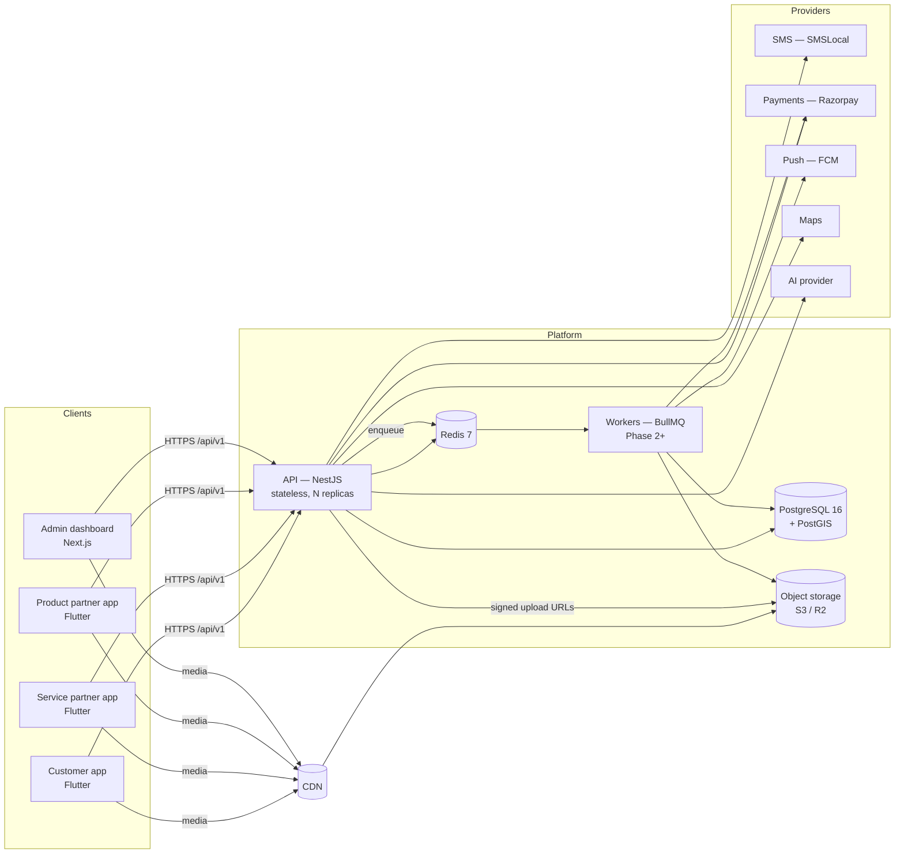
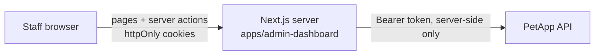
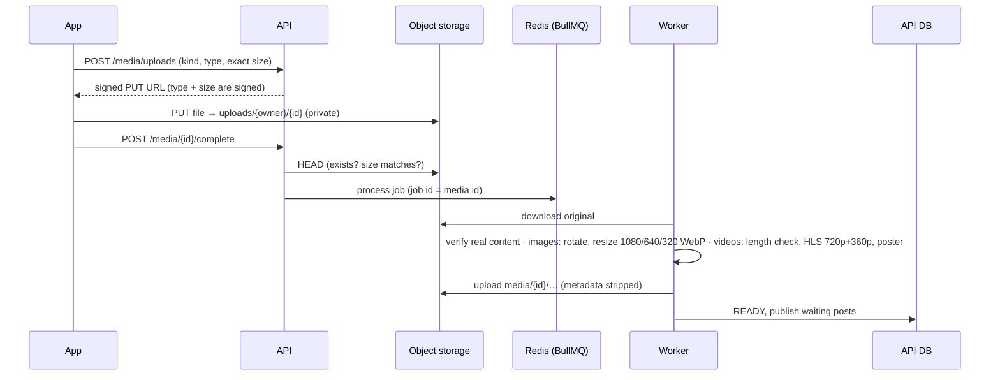
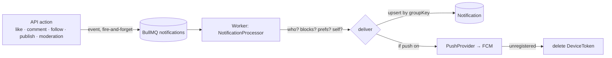

# PetApp — System Architecture

## 1. Components



| Layer | Choice | Why |
|---|---|---|
| API | NestJS 10, TypeScript strict | Modules, DI and guards fit a large RBAC surface |
| ORM | Prisma 7 with the `pg` driver adapter | Typed queries; no native query engine at runtime, so the image is smaller |
| Database | PostgreSQL 16 (+PostGIS from Phase 4) | Relational integrity for money, geospatial queries for "near me" |
| Cache / queues / rate limits | Redis 7 | Shared across replicas, so the API stays stateless |
| Jobs | BullMQ on Redis (Phase 2) | Video transcoding, notifications, settlements, reconciliation |
| Media | S3-compatible storage + CDN, signed uploads | Large files never pass through the API or the database |
| Mobile | Flutter (3 apps) | One codebase for Android and iOS |
| Admin | Next.js + Tailwind | Desktop/tablet dashboard |

## 2. Monorepo layout

```
petapp/
├── apps/
│   ├── backend/                 NestJS API (Phase 1 ✔)
│   ├── admin-dashboard/         Next.js 15 (Phase 1b ✔)
│   ├── customer-mobile/         Flutter (Phase 2c ✔)
│   ├── service-partner-mobile/  Flutter (Phase 4)
│   └── product-partner-mobile/  Flutter (Phase 5)
├── packages/
│   └── types/                   Shared role/permission/flag keys and API envelope types
├── prisma/                      schema, migrations, seed
├── infrastructure/              Dockerfile, DB init
├── docs/
└── .github/workflows/           CI + deploy
```

`packages/api-client`, `validation`, `ui` and `config` from the original plan are created when a second consumer exists (the admin dashboard), so nothing is generated before it is used.

## 3. Backend module map

```
src/
├── config/        Zod-validated environment; the app refuses to boot on bad config
├── prisma/        PrismaService (pg adapter)
├── redis/         RedisService (cache, rate limits, later queues)
├── common/        guards, decorators, response envelope, error filter, utils
├── providers/     sms/ (SmsProvider → console | smslocal); later storage, payment, push, maps, ai
└── modules/
    ├── auth/      OTP, email, Google, Apple, admin login, token rotation
    ├── rbac/      roles, permissions, access cache
    ├── users/     profile, addresses, follows, admin user management
    ├── pets/      pets, vaccinations, follows, discovery, species/breeds, admin moderation
    ├── platform/  feature flags, settings, FeatureGuard
    ├── audit/     append-only audit log
    └── health/    /health, /ready
```

## 4. Request pipeline

`request-id → helmet → CORS → JSON body (1 MB) → ThrottlerGuard (Redis) → AuthGuard → PermissionsGuard → FeatureGuard → ValidationPipe (whitelist, forbid unknown) → controller → ResponseInterceptor → AllExceptionsFilter`

- Every route requires authentication unless marked `@Public()` or `@OptionalAuth()`.
- `@AdminOnly()` routes accept only admin-audience tokens, and admin tokens are refused on app routes. A stolen app token cannot reach the dashboard API.
- User status and permissions are re-checked on every request through a 60-second Redis cache. Suspensions and role changes invalidate the cache immediately.

## 5. Auth design

- **Access token:** a JWT (HS256), 15 minutes by default. Claims are `sub`, `sid` (session), `aud` (`petapp:app` or `petapp:admin`) and `iss`.
- **Refresh token:** an opaque 48-byte random value. Only its HMAC is stored, in `Session`.
  - It rotates on every refresh.
  - Reusing an already-rotated token revokes the whole session family, which is how theft is detected.
- **OTP:**
  - The code is stored only as an HMAC with a server pepper.
  - Each code expires, allows a limited number of attempts and is consumed atomically.
  - Requests have a per-number resend cooldown, a per-number hourly cap and a per-IP rate limit.
  - The app responds the same way whether or not the number already has an account.
- **Social sign-in:** Google and Apple ID tokens are verified on the server against the configured client IDs. An existing account is linked only when the provider has verified the email.
- **Admin login:** email and password, plus a staff role (`Role.isStaff`). Admin refresh tokens last 12 hours.

## 6. Data principles

- UUID primary keys and `createdAt` / `updatedAt` everywhere. `deletedAt` is used where a soft delete matters (users, pets).
- Money will be stored as integer paise in an append-only ledger (Phase 6); floats are never used.
- `AuditLog` is append-only, enforced by a database trigger (migration `…_audit_log_append_only`). The application also writes audit rows inside the same transaction as the change they record.
- Business rules that must be configurable live in `AppSetting` / `FeatureFlag` or in dedicated config tables, never in code.

## 7. Scalability path

| Users | Change |
|---|---|
| ≤10k | 1–2 API replicas, a managed Postgres, one Redis |
| 100k | More API replicas behind a load balancer (the API holds no state), read replica for feeds and search, separate worker pool |
| 1M+ | Partition high-volume tables (views, votes, ledger) by time, a dedicated search index, CDN caching of public pet and product pages, separate Redis for queues and cache |

## 8. Provider abstraction

Every third-party service sits behind an interface chosen by environment variable. That lets a provider be swapped without touching business code.

| Interface | Implementations (`*_PROVIDER`) | Phase |
|---|---|---|
| `SmsProvider` | `console` (dev only), `smslocal` | 1 ✔ |
| `StorageService` | S3 API: AWS S3, Cloudflare R2, MinIO (`S3_*`); presigned and multipart uploads | 2 ✔, 9e |
| `PushProvider` | `none`, `console` (dev only), `fcm` | 2 ✔ |
| `PaymentProvider` | `fake` (dev only), `razorpay` (checkout, signed webhooks, refunds) | 3 ✔ |
| `PayoutProvider` | `fake` (dev only), `razorpayx` (fund-account checks, payouts) | 6b ✔ |
| `MapProvider` | `none` (PetApp's location database only), `google` (Geocoding API, India) | final ✔ |
| `AiProvider` | `rules` (built-in), `anthropic` (Claude Messages API, forced tool output) | 7a ✔ |
| `AssistantProvider` | `rules` (built-in keyword answers), `anthropic` (Claude Messages API with server-run tools) | 7c ✔ |
| `EmailProvider` | `none`, `console` (dev only), `smtp` (any SMTP service) | 9e ✔ |

Production and staging refuse the development-only implementations (env validation).

## 9. Admin dashboard (Phase 1b)



- **Backend-for-frontend.** The browser only talks to the Next.js server. API calls happen server-side, so tokens never reach page scripts and the API needs no browser CORS.
- **Session cookies.** `pa_at` (access token) and `pa_rt` (refresh token) are `httpOnly`, `SameSite=Strict`, and `Secure` in staging and production.
- **Refresh.** `middleware.ts` refreshes the access token when it is missing or has less than a minute left, before the page renders.
- **Parallel requests.** The API's 15-second refresh-reuse grace window absorbs parallel requests, such as link prefetches.
- **Mutations.** These are Next.js server actions; Next checks the request's Origin against the host, which protects against cross-site request forgery. Each action re-validates its input and the API validates again.
- **Permissions.** These are read from `/admin/auth/me` once per request. Menu items, pages and action buttons are hidden without the matching permission, and the API enforces every check regardless.
- **History.** Every person and pet page shows that record's audit trail beside it.
- **Open redirects.** The post-login destination must be a same-site path.
- **Headers.** Security headers are set: `X-Frame-Options: DENY`, `nosniff`, a strict referrer policy, HSTS and a restrictive permissions policy.

## 10. Media pipeline (Phase 2)



- **Privacy:** originals stay private. Every served variant has its metadata removed, including photo GPS EXIF and video location tags, and a test verifies this on a real file.
- **Trust:** the declared MIME type is never trusted; the worker checks the actual content with sharp or FFprobe. Size is enforced twice, in the upload signature and again by a HEAD check on confirm.
- **Retries:** a broken file is rejected straight away, while network or storage errors are retried 3 times with backoff. A post waits in PROCESSING until all its media are ready, then publishes itself. If any media fails, the post is marked FAILED.
- **Scheduled jobs:** the trending score is recomputed every 10 minutes for posts from the last 7 days. Abandoned uploads are cleaned up daily.
- **Deployment:** the worker is the same image as the API (`node apps/backend/dist/worker.js`) and scales on its own with `MEDIA_CONCURRENCY` per process.
- **Delivery:** set `MEDIA_PUBLIC_BASE_URL` to a CDN, or a public `media/` prefix, in front of the bucket. **This is required for video.** HLS playlists reference their segments by relative path, which per-file signed URLs can't cover. Without it, photos still work through 1-hour signed URLs, but video won't play, and the API logs a warning at startup. Originals under `uploads/` are never public.

## 11. Notifications (Phase 2b)



- **Events, not notifications.** API actions emit events such as "Riya liked post X". The worker decides who hears about them. A queue failure is logged and never breaks the user's action.
- **Rules:**
  - Nobody is notified about their own actions.
  - Nothing is sent across a block.
  - Recipients must be active.
  - Category preferences are respected; account and moderation notices always arrive.
  - Each actor counts once per group, tracked in Redis for 30 days.
  - @mentions reach a pet's owner only if they can see the post.
- **Text** is rendered when it's read (`render.ts`), so wording can change without a migration. The same text is used for push.
- **Push data** carries `type`, `entityType` and `entityId`, so the app can deep-link from a push.
- **The app's responsibility:** register a device token after sign-in with `POST /devices`, and remove it before sign-out with `DELETE /devices/:token`.

## 12. Contests and payments (Phase 3a)

**Lifecycle.** DRAFT → REVIEW → SCHEDULED → LIVE → VOTING → EVALUATION → WINNER_DECLARATION → COMPLETED. Any stage before WINNER_DECLARATION can move to CANCELLED. Each step is checked:
- **REVIEW and SCHEDULED:** readiness — tasks, prizes, judges and criteria weights totalling 100, dates in order, and a money split of 100% or less.
- **LIVE:** a paid contest needs a recorded legal review, which only super admins can record by default.
- **VOTING:** the minimum number of entries must be met.
- **WINNER_DECLARATION:** the leaderboard must be frozen.
- **CANCELLED:** a reason is required. Captured entry fees become `REFUND_PENDING`, and the finance module executes refunds in Phase 6, so none are lost.

**Money.** Integer paise and basis-point arithmetic. Any rounding remainder is reported as `unallocatedPaise`, never silently assigned. `GET /admin/contests/:id/finance/:n` answers "what if N people enter?" — for example, 100 × ₹100 splits ₹6,000 / ₹2,000 / ₹360 GST / … with nothing left over.

**Payments.**
- The app opens the gateway checkout and returns its signature to the API. The API verifies it, as Razorpay documents: HMAC-SHA256 of `order_id|payment_id` with the key secret.
- Webhooks are verified over the raw request bytes, stored once by event ID (so duplicates are no-ops), and amount-checked against the order.
- Unpaid registrations hold a place for 30 minutes. The contest row is locked during registration, so the last place can't be sold twice.

**Score.** `combined = publicWeight × voteScore + (100 − publicWeight) × judgeScore`, each on a 0–100 scale:
- votes are scaled against the entry with the most votes;
- judges' weighted criteria average 0–10, multiplied by 10;
- ties go to the earlier registration.

The live board is cached for 30 seconds and cleared on any change. After the freeze, the board is read from the snapshot.

**Vote integrity.**
- Hard rules: a verified phone, minimum account age, a per-day limit across the contest, one vote per entry per day, and no voting for your own entry.
- Risk signals: an account under 24 hours old, an account created after the contest opened, and many votes from the same network for the same entry. Votes scoring 50 or more are flagged.
- Flagged votes don't count until a moderator approves them. The voter isn't told, so fraud rings can't learn the thresholds. Nobody is banned automatically.

## 13. Challenges (Phase 3c)

- **Days:** a day is an **India calendar day** (Asia/Kolkata), so check-ins at 11:59 pm and 12:01 am IST are two days.
- **Concurrency:** a check-in locks the participant row (`FOR UPDATE`). The unique (participant, day) key backs this up, so double taps can't double-count.
- **Scoring:** consecutive days build the streak and a gap resets it. Points are `pointsPerCheckIn`, plus `streakBonusPoints` on every Nth consecutive day. The pure rules are in `challenge.rules.ts` and unit tested.
- **Completion:** happens exactly once, when check-ins reach `requiredCheckIns`. It awards the challenge's badge (idempotent) and sends CHALLENGE_COMPLETED and BADGE_EARNED notifications. People can keep checking in afterwards for points.
- **Ranking:** points, then longest streak, then earliest join. The viewer's own rank is computed exactly, even outside the top 100.
- **Paid challenges** reuse the payments module (purpose `CHALLENGE_JOIN`). Cancelling queues refunds, as with contests.
- **Contest notifications:**
  - entry confirmed, on free registration or verified payment;
  - voting open, to all active entrants;
  - results, after winners are declared — winners hear "You won!" with the prize, everyone else gets a thank-you.

## 14. Services marketplace (Phase 4a)

- **Location:** `ServicePartner.location` is a PostGIS `geography(Point, 4326)`, kept in step with `lat`/`lng` by a trigger and indexed with GIST. Nearby search uses `ST_DWithin` and `ST_Distance` in metres.
- **Slots** are pure functions (`services.rules.ts`) over opening hours in India time, time off, buffer, lead time and staff capacity.
- **Double booking is impossible at the database level.** The exclusion constraint `Booking_no_overlap` covers (partner, staff slot, time range `[)`) for active statuses. The application picks a free staff slot and retries once if it loses a race; the constraint is the backstop.
- **Holds:** unpaid bookings hold their slot for `services.paymentHoldMinutes`. Expired holds are released *before* slots are computed, in the same transaction as the booking.
- **Money:** every booking stores the price, platform fee and partner earning in paise. Refund amounts follow platform settings and who cancelled. Executing refunds and payouts is Phase 6.
- **KYC documents** go to a private storage prefix via signed upload. Admins view them through short-lived signed links; they're never public.

## 14. Product marketplace (Phase 5a)

**Money model.**
- Prices are **GST-inclusive**, as Indian retail prices are. Each order line records the GST it contains (`price × rate / (100 + rate)`), which Phase 6 invoices will use.
- One checkout is **one payment** split into a **sub-order per vendor**. A coupon discount is allocated across eligible lines by largest remainder, so the parts always add up exactly. Shipping is charged per vendor parcel and is free at or above a threshold, decided after the discount.
- **Commission** is the vendor's agreed rate if set, otherwise the category's rate, applied per line on the net price.
- **Who funds a coupon:** a **vendor-funded** coupon reduces that vendor's earnings. A **platform-funded** coupon is PetApp's cost, and vendors still earn on the full price.
- Invariant, tested on 2,000 random carts: for every parcel, `total = vendor earnings + platform net`.

**Stock under concurrency.**
- Placing an order decrements each variant with a conditional update (`stock >= qty`) inside the order transaction. With several buyers racing for the last units, exactly one order succeeds and the others roll back with a clear "just sold out" message.
- Unpaid orders hold their stock for `marketplace.paymentHoldMinutes` (30). Stale holds are released before every checkout, returning both stock and coupon uses.
- A late payment either re-reserves the stock and revives the order, or queues a full refund (`Order:<id>`).

**Lifecycle.**
- A parcel moves CONFIRMED → PACKED → SHIPPED (courier and tracking required) → DELIVERED.
- The customer can cancel while CONFIRMED; the vendor can cancel before SHIPPED. Either way, that parcel is refunded in full and restocked.
- Returns are accepted within `marketplace.returnWindowDays` (7) after delivery. The refund is the item value after discount; shipping isn't refunded. Stock is restored when the vendor marks the return received.
- The master order becomes COMPLETED when every parcel reaches an end state, or CANCELLED if all were cancelled.

**Refunds** are recorded once per reference in `Refund` and sent to the gateway by the finance worker (section 15).

**Settings** (admin-editable): shipping fee, free-shipping threshold, return window, payment hold, and maximum quantity per item.

## 15. Finance: ledger, refunds, reconciliation (Phase 6a)

**Double-entry ledger.** Every money event is a balanced posting (`LedgerTransaction` + `LedgerEntry` lines). The database enforces the rules:
- Each line is either a debit or a credit, positive, never both (check constraint).
- Every transaction has at least two lines and debits equal credits, checked by a deferred constraint trigger at commit.
- Lines and transactions can't be updated or deleted (triggers). Corrections are new, reversing postings.
- `reference` is unique, so posting the same event twice does nothing. That makes repairs and retries safe.

Postings are made in the same database transaction as the business change, so money moves exactly when the change commits.

| Event | Debit | Credit |
|---|---|---|
| Payment captured | Gateway clearing | Customer funds |
| Refund owed (cancellation, return, late cancellation, unhonoured payment) | Customer funds | Refunds due |
| Refund confirmed by the gateway | Refunds due | Gateway clearing |
| Parcel delivered / visit completed / no-show / late-cancellation charge | Customer funds (+ PetApp coupons expense) | Fee revenue, GST on fees, TCS payable, TDS payable, payee account |
| Return received | the delivery posting, reversed | (shipping kept by the seller) |

**Fees and taxes** (settings `finance.*`, editable by admins; confirm rates with a tax adviser):
- Commission and booking fees **include 18% GST**: revenue is the fee without it.
- **GST TCS** (section 52) is collected only from GST-registered sellers and partners, on the taxable value: price less the GST inside it, after discounts.
- **Income-tax TDS** (section 194-O) is deducted from everyone. A higher rate (section 206AA) applies when no PAN is on file.
- What's left is credited to the payee's own account (`VENDOR:<id>`, `PARTNER:<id>`). That balance is what PetApp owes them; payouts arrive in Phase 6b.

**Refund execution** (worker, every 30 seconds).
- A refund is claimed `PENDING → PROCESSING` by one worker at a time.
- Each attempt sends its own receipt and idempotency key: the refund id plus the attempt number.
- Before a new attempt, the worker looks up every earlier attempt at the gateway. One that is pending or went through is followed instead of sending another. So a timeout followed by a retry can never refund twice, while a refund the bank rejected can be tried again.
- Only the attempt in flight can fail a refund; a stale report about an older attempt changes nothing.
- Errors back off exponentially (2, 4, 8 … minutes, capped at 6 hours). Refusals, or `finance.refundMaxAttempts` failures, end as `FAILED`.
- Finance staff can retry a `FAILED` refund (another round of attempts). Or, if they paid the customer another way, they record it with the transfer reference (`SETTLED_MANUALLY`): the debt is settled from PetApp's bank account instead of the gateway.
- Webhooks: a repeated event whose earlier handling failed is handled again rather than dropped as a duplicate.
- Completion arrives by the create response, a signed `refund.processed` webhook, or polling, whichever comes first. Applying it is idempotent.
- The payment's status follows its refunds: CAPTURED → REFUND_PENDING (whole amount owed) → PARTIALLY_REFUNDED / REFUNDED.

**Races closed in this phase:**
- Booking cancellation and completion move only from the status they were decided on, so they can't both happen.
- A capture locks its contest or challenge, so a cancellation running at the same moment either sees the payment and refunds it, or the payment sees the cancellation and is refunded.
- A return can be received only once.
- Payment status updates lock the payment row.

**Reconciliation** (nightly at 02:30 India time, or on demand).
- **Repairs** business events that have no posting, e.g. data from before the ledger.
- **Checks:**
  - Every transaction balances.
  - Gateway clearing equals captured minus refunded.
  - Refunds due equals unpaid refunds.
  - Customer funds never go negative.
  - No payment is over-refunded.
  - Capture postings match payment amounts.
- **Asks the gateway** about the last `finance.reconcileLookbackDays` of payments. A capture we never heard about (MISSED_CAPTURE) is recovered from the dashboard; the gateway is asked server-to-server, then the payment completes through the normal path.
- **Other gateway findings:** a customer charged twice on one order (DUPLICATE_CAPTURE), or a capture for a different amount (GATEWAY_AMOUNT_MISMATCH). These are refunded from the gateway's dashboard.
- **Control checks** read one repeatable-read snapshot, so live traffic can't cause false alarms.
- **Issues** stay open until resolved with a note. An open issue isn't raised twice, and a finding staff already resolved isn't raised again unless its details change.

## 16. Payouts, settlements and invoices (Phase 6b)

**Payout accounts:**
- **Owners:** sellers, partners and prize winners add a bank account or UPI ID.
- **Encryption:** the account number is encrypted with AES-256-GCM (`PAYOUT_DATA_KEY`). Only the last four digits are ever shown.
- **Validation:** RazorpayX's ₹1 check confirms the account is active and returns the holder's name.
- **Replacing an account:** the new one replaces the old only once verified, so payouts never pause. Payouts to it wait `finance.newAccountHoldHours` (24) if it replaces an earlier account, or if the bank's name isn't one of the payee's names (business, legal or owner).
- **Limits:** at most three changes a day. The payee is notified of every change.

**What's payable:** the payee's ledger balance, counting earnings only after `finance.payoutHoldDays` (7, the return window). Deductions count at once. Bounced payouts and approved prizes count at once.

**Batches (maker-checker):**
- **Prepare:** one staff member prepares a batch. Every payee with at least `finance.minPayoutPaise` payable, a verified account past its hold, and no payout already on its way gets one payout. The database allows one open payout per payee.
- **Approve:** a *different* staff member approves. Each payout is re-checked against the balance under a per-payee lock, and the amount moves to "payouts in transit". Every debit to a payee (returns, refunds) takes the same lock, so nothing slips in between.
- **Send:** the worker sends each payout every 30 seconds. The payout id is the reference and idempotency key, and the payout is looked up at the provider before every attempt.
- **Outcomes:**
  - **Paid:** the money leaves PetApp's bank.
  - **Refused, or the account switched off before sending:** it goes back on the balance.
  - **Timeouts and outages:** never treated as failure (the money may have gone). The payout is retried, then left for the status check.
  - **Returned by the bank:** back on the balance.

**Prizes:**
- **Entry fees:** when a contest completes or a challenge ends, the entry fees still held become revenue (GST split out at `finance.gstOnEntryFeesBps`). A payment arriving after that is refunded.
- **Approval:** finance approves each awarded cash prize. TDS on winnings (`finance.prizeTdsBps`, above `finance.prizeTdsThresholdPaise`) is deducted, and the rest is owed to the winner.
- **Payout:** the prize is linked to the payout that carries it, and marked paid when that payout is.

**Gateway settlements:** synced nightly before reconciliation, and on demand. Each settlement moves money from the gateway to the bank, with the gateway's fees as an expense and their GST as input credit. Reconciliation checks:
- gateway clearing = captured − refunds sent − settled
- payouts in transit = queued + sending payouts

**Invoices:**
- **Numbering:** gapless, one series per issuer, document type and financial year. The number is taken inside the business transaction, so a rolled-back sale leaves no hole.
- **Immutable:** issued invoices can't be changed; a database trigger refuses it.
- **Kinds:**
  - **Seller's invoice:** at delivery, to the customer. Items carry the parcel discount spread by value; shipping follows the principal item's rate. CGST+SGST within a state, IGST across states. A bill of supply if the seller isn't GST-registered.
  - **Credit note:** mirrors the original's item lines when a return is refunded.
  - **Partner's invoice:** for a completed visit (IGST when a home visit is in another state).
  - **PetApp's commission invoice:** monthly, to each seller and partner, from the ledger's fees for that month (only for a finished month, with company details set).
- **PDFs:** rendered on request. Customers and the issuing seller or partner can download their own; finance staff can download any.

