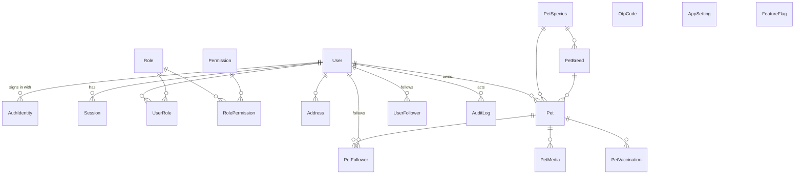
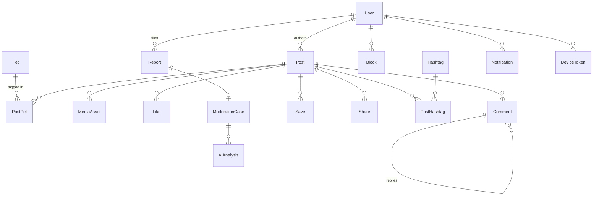
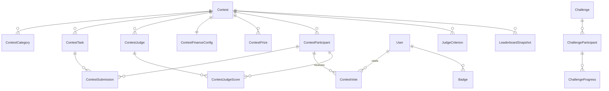
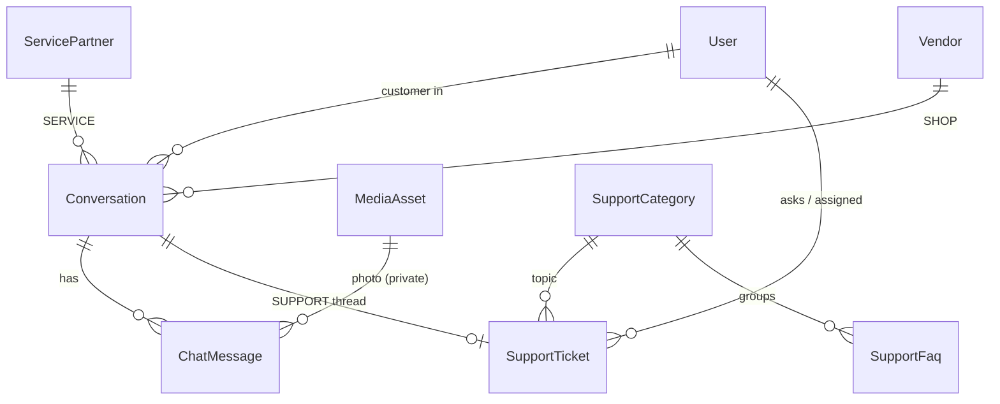
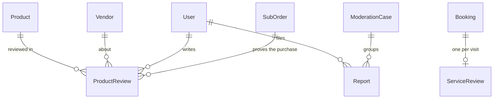
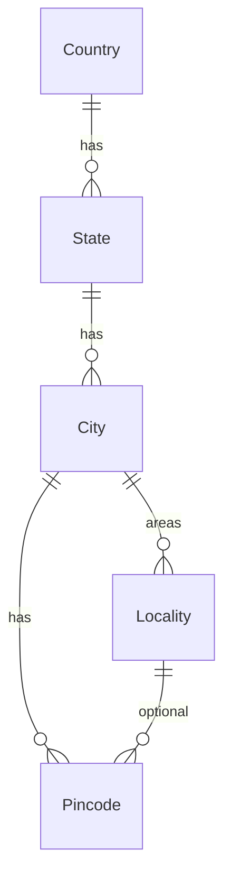
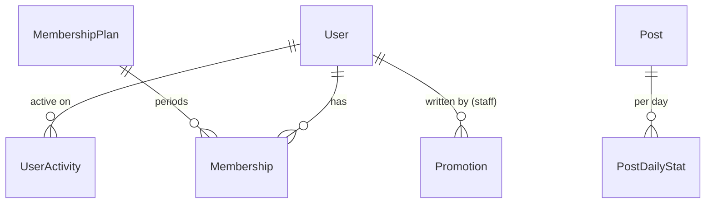

# PetApp — Data Model (all phases)

The **Phase 1** tables are implemented in `prisma/schema.prisma`. Tables for later phases are shown here as the target design. Each phase adds them through its own migration, so the schema never contains tables that nothing uses.

Conventions:
- UUID primary keys and `createdAt` / `updatedAt` on every table.
- `deletedAt` where a soft delete is required.
- Money is an integer in **paise** plus a `currency` column.
- All foreign keys are indexed.

## Phase 1 — Foundation (implemented)

| Table | Purpose / key constraints |
|---|---|
| User | `phone` (E.164) and `email` (lower-case) unique; `status`; `preferences` JSON; `deletedAt` |
| AuthIdentity | unique (`provider`, `providerUserId`) — PHONE / EMAIL / GOOGLE / APPLE |
| OtpCode | HMAC of the code, `attempts`, `expiresAt`, `consumedAt`; index (`phone`, `createdAt`) |
| Session | refresh token HMAC (unique), `familyId`, `audience`, rotation chain |
| Role / Permission / RolePermission / UserRole | configurable RBAC; `Role.isStaff` gates dashboard login |
| Address | Indian PIN code, lat/lng, a single default per user (enforced in a transaction) |
| PetSpecies / PetBreed | admin-managed; unique (`speciesId`, `name`) |
| Pet | unique public `handle`; `visibility`; `status`; `followerCount` denormalised; owner-only fields |
| PetVaccination, PetMedia, PetFollower, UserFollower | |
| AppSetting, FeatureFlag | admin-editable configuration |
| AuditLog | append-only (database trigger); indexes on entity, actor + time, action + time |

## Phase 2 — Social and Reels (implemented: 2a)

Migration `20261002090000_social` adds 13 tables, 11 enums and 22 foreign keys, with no changes to existing tables.

As built:

- **MediaAsset:** status PENDING_UPLOAD → UPLOADED → PROCESSING → READY, or FAILED / REJECTED. Has `storageKey` (the private original), `variants` JSON (WebP widths or HLS + poster), dimensions, duration and attempts.
- **Post:** type PHOTO | VIDEO | REEL; status PROCESSING → PUBLISHED, or FAILED / HIDDEN / REMOVED; visibility PUBLIC | FOLLOWERS. Has denormalised counters and a trending `score`. Linked through PostMedia (ordered), PostPet (tags) and PostHashtag.
- **Engagement:** PostLike and PostSave have composite primary keys, so they're idempotent. PostShare keeps one row per share.
- **Comment:** one level of threading (`parentId`), `replyCount`, and a moderation `status`.
- **Block:** both directions are enforced.
- **Report:** unique per reporter and target. **ModerationCase** groups the open reports for a target; `openKey` (unique while open, NULL once resolved) allows one open case at a time and a fresh case after resolution.
- **Views:** counted once per viewer per day (deduplicated in Redis) into `Post.viewCount`. A partitioned `ReelView` table can come later if analytics need raw events.
- **Feeds:** queried live with keyset pagination for the home feed, and offset pagination for ranked lists. A precomputed Redis feed is the next step for high scale.

## Phase 2b — Notifications (implemented)

Migration `20261002120000_notifications` adds 3 tables and 2 enums, with no changes to existing tables.

- **Notification:** recipient, type, actor, the entity it's about (`entityType` / `entityId`), a small `data` payload, `count` and `readAt`. Unique (`userId`, `groupKey`), so repeated events update one row ("Riya and 4 others liked your post"). Every delivery has a group key, which makes queue retries idempotent.
- **DeviceToken:** an FCM token, unique, belonging to one account at a time. It's removed when FCM reports it dead, or when the account is suspended or deleted.
- **NotificationPreference:** push on or off, plus switches for likes, comments, mentions, follows and posts. Account and moderation notices can't be switched off.

## Phase 3a — Contests and payments (implemented)

Migration `20261003090000_contests` adds 13 tables and 4 enums, with no changes to existing tables.

- **Contest:** lifecycle status, fee in paise, minimum and maximum entries, four dates in order, `publicWeight` (the judges get the remainder), votes per user per day, minimum account age, eligible species, rules and terms, and `finance` JSON (percentages plus fixed judge fees). It also records the legal review (who, when, note), the freeze time and the cancellation reason.
- **ContestCategory:** admin-managed, grouped (BEAUTY, TALENT, FUN, PHOTOGRAPHY, SKILLS, CHALLENGE, or any group admins add).
- **ContestTask** (POST or TEXT), **JudgeCriterion** (weights total 100), **ContestJudge**, **ContestPrize:** rank or special award, kind, amount, the awarded entry, and payout status.
- **ContestParticipant:** unique (contest, pet). Status runs PENDING_PAYMENT → REGISTERED → SUBMITTED → QUALIFIED / FINALIST → WINNER, or DISQUALIFIED / WITHDRAWN.
- **ContestSubmission:** unique (entry, task).
- **ContestVote:** unique (contest, voter, entry, day), with an IP hash, risk score and reasons, and a `flagged` marker.
- **ContestJudgeScore:** unique (entry, judge, criterion), scored 0–10.
- **LeaderboardSnapshot:** the frozen ranking that winners are declared from.
- **Payment:** purpose, reference, amount in paise, provider order ID (unique), provider payment ID (unique), status (CREATED → CAPTURED, or FAILED, REFUND_PENDING, REFUNDED).
- **PaymentWebhookEvent:** unique (provider, event ID), which makes redelivery harmless.

Still planned below: challenges, streaks and badges (3c), and the full ledger, refunds and payouts (Phase 6).

## Phase 3c — Challenges and badges (implemented)

Migration `20261004090000_challenges` adds 5 tables and 4 enums, and appends 5 values to `NotificationType` with `ALTER TYPE … ADD VALUE`. It is still purely additive.

- **Challenge:** kind (FREE, PAID or CONTEST_LINKED with `contestId`), fee, window (`startsAt` to `endsAt`), `requiredCheckIns`, proof (NONE, POST or TEXT), points per check-in, streak bonus (every N days, +P), badge, and status (DRAFT → PUBLISHED → ENDED, or CANCELLED).
- **ChallengeParticipant:** unique (challenge, user). Holds points, check-ins, current and longest streak, `lastCheckInDay` (DATE), and status (PENDING_PAYMENT, ACTIVE, COMPLETED or WITHDRAWN).
- **ChallengeCheckIn:** unique (participant, day). The day is the India calendar day.
- **Badge** and **UserBadge** (unique per user and badge, with its source).

## Phase 3 — Contests and challenges (original plan)

- **Contest:** lifecycle status (DRAFT → REVIEW → SCHEDULED → LIVE → VOTING → EVALUATION → WINNER_DECLARATION → COMPLETED), dates, `feePaise`, min/max participants, `publicWeight` and `judgeWeight` (configurable, never hard-coded), `legalReviewApprovedAt` (the real-money gate) and `leaderboardFrozenAt`.
- **ContestFinanceConfig:** prize pool %, platform fee %, gateway %, tax rule id, judge fees, promotion %, refund reserve %.
- **ContestVote:** unique (`contestId`, `voterId`, `participantId`, `voteDate`), with `deviceHash`, `ip` and `riskScore`.
- **FraudSignal:** `entityType`, `entityId`, `signal`, `score`, `reviewedBy`. It never bans anyone automatically.

## Phase 4 — Services marketplace and locations

- **Location** (country → state → city → locality → pincode, plus a PostGIS `geography(Point)` column).
- **ServiceCategory.**
- **ServiceProvider:** business details, a verification status (PENDING → UNDER_REVIEW → APPROVED → ACTIVE → SUSPENDED), `serviceRadiusKm` and a `location` geography column with a GiST index.
- **ProviderDocument, ProviderStaff, Service, ServiceAddOn.**
- **ServiceAvailability** (weekly hours), **ServiceBlackout** (holidays and breaks).
- **Booking:** status flow REQUESTED → ACCEPTED → CONFIRMED → IN_PROGRESS → COMPLETED | CANCELLED.
- **BookingItem.**
- **BookingSlotLock:** an exclusion constraint on (provider/staff, `tstzrange`) prevents double booking at the database level.
- **CancellationPolicy.**
- **Review:** `targetType`, `targetId`, rating 1–5, `isVerified`, `partnerReply`.

## Phase 5 — Product marketplace

- **Vendor** (with verification).
- **ProductCategory** (tree), **Product**, **ProductVariant** (SKU unique), **ProductMedia**, **Inventory** (on hand, reserved, status).
- **Cart**, **CartItem**, **SavedItem**.
- **Order:** the master order.
- **SubOrder:** one per vendor, with status flow PENDING → CONFIRMED → PACKED → SHIPPED → OUT_FOR_DELIVERY → DELIVERED | CANCELLED | RETURNED | REFUNDED.
- **OrderItem**, **Shipment**, **ReturnRequest**.
- **Coupon** and **CouponRedemption:** unique (`couponId`, `userId`, `orderId`).

## Phase 6 — Finance

- **Payment:** the gateway, `gatewayOrderId`, `gatewayPaymentId` (unique), `purpose` (CONTEST | ORDER | BOOKING | SUBSCRIPTION), `referenceId`, `amountPaise` and `status`.
- **PaymentWebhookEvent:** `eventId` unique, which makes webhook handling idempotent.
- **Refund.**
- **LedgerAccount** (USER_WALLET, PLATFORM_REVENUE, PRIZE_POOL, PARTNER_PAYABLE, GST_PAYABLE, GATEWAY_FEES, …).
- **LedgerEntry:** append-only double-entry records; every transaction nets to zero.
- **Wallet:** a balance view derived from the ledger.
- **CommissionRule**, **TaxRule** (GST rate, HSN/SAC, CGST/SGST/IGST split, TDS/TCS).
- **Invoice**, **PartnerPayout** (PENDING → APPROVED → PROCESSING → PAID | FAILED), **PrizePayout**.

## Phase 7 — AI

- **AIAnalysis:** entity, model, model version, result JSON, confidence, reason, `createdAt`.
- **RecommendationEvent:** implicit feedback.
- **AssistantConversation** and **AssistantMessage.**

## Phase 8 — Production

- **SupportTicket** (OPEN → ASSIGNED → IN_PROGRESS → WAITING → RESOLVED → CLOSED), **TicketMessage**, **FaqArticle**.
- **ConsentRecord**, **DataExportRequest**, **DeletionJob.**

## Phase 5a — Product marketplace (implemented)

Migration `20261007090000_marketplace` adds 13 tables and 6 enums, and appends 4 values to `NotificationType`. It is purely additive.

- **Vendor:** a store owned by one user, with a pickup and returns address, optional GSTIN, status (DRAFT → SUBMITTED → APPROVED, or REJECTED / SUSPENDED) and an optional agreed `commissionBps`. **VendorDocument** holds private KYC files, the same kinds as service partners.
- **ProductCategory:** one level of nesting, each with a standard `commissionBps`.
- **Product:** title, description, brand, species, ordered `imageIds`, and status (DRAFT, ACTIVE, INACTIVE or BLOCKED, the last with a reason). **ProductVariant:** unique SKU per product, MRP, a GST-inclusive selling price, `gstRateBps`, and stock. Variants are deactivated, never deleted, because past orders point at them.
- **CartItem:** keyed by (user, variant).
- **Coupon:** PERCENT (basis points) or FLAT (paise), cap, minimum order, window, usage and per-user limits, and optional `vendorId` (vendor-funded). **CouponRedemption** has one row per order.
- **Order:** one checkout and one payment. Holds totals and a snapshot of the shipping address. **SubOrder** is one parcel per vendor, with its own totals, commission, vendor earnings, courier and tracking, and status. **OrderItem** stores the line as sold, including title, SKU, price, GST contained and commission rate.
- **ReturnRequest:** REQUESTED → APPROVED → RECEIVED, or REJECTED. The refund amount is fixed when the return is requested.
- **Refund:** money owed back. It's unique per `reference` (`SubOrder:<id>`, `Return:<id>`, `Order:<id>`), so it can't be queued twice. It's PENDING until the finance module (Phase 6) executes it.

## Phase 6a — Finance (implemented)

Migration `20261011090000_finance` is additive. It adds 5 tables and 2 enums, appends values to `NotificationType` (REFUND_PROCESSED), `PaymentStatus` (PARTIALLY_REFUNDED) and `RefundStatus` (PROCESSING, FAILED), and adds columns to `Refund`, `Vendor` and `ServicePartner`.

- **LedgerAccount:**
  - Fields: `code` (unique), name, type (ASSET | LIABILITY | REVENUE | EXPENSE), and an optional owner (VENDOR or PARTNER + id) for payee accounts.
  - System accounts: GATEWAY_CLEARING, CUSTOMER_FUNDS, REFUNDS_DUE, FEE_REVENUE, GST_PAYABLE, TCS_PAYABLE, TDS_PAYABLE, PLATFORM_DISCOUNTS.
- **LedgerTransaction:** kind, `reference` (unique, so postings are idempotent), memo, source (e.g. SubOrder + id) and `occurredAt`. Append-only.
- **LedgerEntry:** transaction, account, `debitPaise` or `creditPaise`. Append-only. Database guards: one-sided positive lines (check constraint), and at least two balanced lines per transaction (deferred constraint trigger).
- **Refund** gains:
  - `providerRefundId` (unique), `attempts` (never reset) and `retries` (staff retries).
  - `lastError`, `nextAttemptAt` and `updatedAt`, with indexes for the worker's queue.
  - `manualReference` and `settledById`, for a refund paid outside the gateway (status `SETTLED_MANUALLY`).
- **ReconciliationRun:** trigger, status (RUNNING → OK | ISSUES | FAILED), summary counts and timing. **ReconciliationIssue:** kind, severity, reference, detail, `repaired`, and resolution (who, when, note).
- **Vendor.pan** and **ServicePartner.pan:** for TDS.

The original Phase 6 plan's wallet, commission and tax rule tables aren't needed:
- Balances come from the ledger.
- Commission rates stay on categories, sellers and partners.
- Tax rates are settings.

Invoices, payouts and prize payouts come in Phase 6b.

## Phase 6b — Payouts, settlements, invoices (implemented)

Migration `20261012090000_payouts` is additive. It adds 6 tables and 4 enums, appends `PAYOUT_UPDATE` and `PAYOUT_ACCOUNT` to `NotificationType`, and adds `ContestPrize.payoutId`.

- **PayoutAccount:**
  - Owner (VENDOR, PARTNER or USER and an id) and method (BANK or UPI).
  - Holder name, IFSC, last 4 digits, encrypted account number, VPA.
  - Status (PENDING → VERIFIED | FAILED, or DISABLED), the bank's name for the account, provider ids, and `payableFrom` (safety hold).
  - At most one VERIFIED account per owner (partial unique index).
- **PayoutBatch:** code, status (DRAFT → PROCESSING → COMPLETED, or CANCELLED), who prepared it and who approved it.
- **Payout:**
  - Payee, account, amount (positive, enforced by a check), purpose (EARNINGS or PRIZE).
  - Status (DRAFT → QUEUED → PROCESSING → PROCESSED | FAILED | REVERSED, or CANCELLED), provider id, UTR, attempts.
  - At most one open payout per payee (partial unique index).
- **GatewaySettlement:** provider id (unique per provider), amount to bank, fees, GST on fees, UTR, date.
- **InvoiceSequence:** next number per series.
- **Invoice:**
  - kind (CUSTOMER, COMMISSION or CREDIT_NOTE), title (tax invoice, bill of supply, credit note), series and number, financial year, `sourceKey` (unique per kind).
  - Issuer and recipient snapshots, place of supply, lines, totals by tax, customer and payee for access, and the original invoice for credit notes.
  - Immutable (trigger).

## Phase 9a — Chat and support (implemented)

- **Conversation:** one per customer and partner (or seller), or one per support ticket. Unread counts and read times for each side.
- **ChatMessage:** body, photo, or a card (`refType`/`refId`: booking, product or order); `internal` for staff notes; `clientId` makes sends idempotent; `status` for moderation.
- **SupportTicket:** code, topic, priority, status (OPEN → ASSIGNED → IN_PROGRESS ↔ WAITING → RESOLVED → CLOSED), assignee, the app it came from, first response and resolution times.

## Phase 9b — Reviews and reporting (implemented)

- **ProductReview:** one per person per product (`customerId`, `productId` unique), with the delivered parcel that proves the purchase and the size bought. Rating 1–5 (checked by the database), words, up to 4 public photos (`photoIds`), one reply from the seller, `status` VISIBLE or HIDDEN.
- **ServiceReview:** now also has `photoIds`; ratings are checked 1–5 by the database.
- **Product** has `ratingAvg` and `ratingCount`; **Vendor**'s rating is the average across its products. Both are recomputed in the same transaction that adds, hides or restores a review.
- **Report:** `evidenceIds` holds up to 3 private screenshots. `ReportTarget` gains `SERVICE_PARTNER` (a business page) and `PRODUCT_REVIEW`.
- `NotificationType` gains `REVIEW_RECEIVED` (to the business) and `REVIEW_REPLY` (to the reviewer).

## Phase 9c — Locations, search and discovery (implemented)

- **Country, State:** India and its 36 states and union territories (ISO 3166-2:IN codes, 2023 update), seeded.
- **City:** name, slug, centre point (`lat`/`lng`, and a PostGIS `location` kept by a trigger), `isActive`, `servicesLive` (service coverage).
- **Locality:** an area of a city, with an optional point.
- **Pincode:** six digits (checked by the database), its city, optional area and point. Imported in bulk from CSV.
- **DeliveryZone:** PIN codes or prefixes (`4110*`), cities and states; deliverable or not; shipping per parcel and free-above amount (null = the standard settings); delivery days. The most specific match wins.
- **Pet:** `discoverable` (owner opt-in for "Pets near you") and a PostGIS `location` from `latitude`/`longitude`.
- **Search indexes:** trigram (`pg_trgm`) GIN indexes on pet names and handles, people's names, product titles, business names, service names, contest and challenge titles, and post captions.

## Phase 9d — Analytics, memberships and promotions (implemented)

- **UserActivity** (`day`, `userId`): one row per person per India-time day they used the app signed in. Only the day is kept, never what they did. Feeds daily and monthly active users and retention.
- **PostDailyStat** (`postId`, `day`, `views`, `completions`): views (once per viewer per post per day) and watched-to-the-end counts.
- **MembershipPlan:** key (`FREE`, `PLUS`, `PREMIUM`, or one an admin adds), price, length in days, order, and benefit switches: `exclusiveContests`, `premiumChallenges`, `memberDiscounts`, `priorityDays`, `badge`.
- **Membership:** one paid (or staff-given) period: `PENDING_PAYMENT` → `ACTIVE` → `EXPIRED`, or `REVOKED` by staff. A renewal is a new row starting when the previous one ends. `paymentId` links the payment (purpose `MEMBERSHIP`); `source` is `PURCHASE` or `GRANT`.
- **Promotion:** title, message, an optional in-app link, audience (`ALL`, `MEMBERS` or one `CITY`), when to send, status (`QUEUED` → `SENDING` → `SENT`, or `CANCELLED`) and how many people it reached.
- **Contest, Challenge, Coupon** gain `membersOnly`. **Booking** gains `remindedAt`. **NotificationPreference** gains `reminders`, `votes` (on by default) and `promotions` (off by default).
- `NotificationType` gains `BOOKING_REMINDER`, `CONTEST_REMINDER`, `CONTEST_VOTES`, `MEMBERSHIP_UPDATE` and `PROMOTION`. The ledger gains the `MEMBERSHIP_REVENUE` account and `MEMBERSHIP_EARNED` postings.

## Phase 9e — Staff passwords and resumable uploads (implemented)

- **PasswordReset:** one emailed reset link: `tokenHash` (SHA-256 of the token; the token itself is never stored), `expiresAt` (30 minutes by default), `usedAt`, `requestedBy` (`SELF` or `STAFF`), `requestedIp`. A new link uses up any earlier one.
- **User** gains `passwordChangedAt` (null while a staff member still uses the password they were given).
- **MediaAsset** gains `multipartUploadId` and `partSize` while a large upload is being sent in parts; both are cleared when it's joined.

## Phase 10a — Staff two-factor sign-in (implemented)

- **User** gains `mfaSecret` (the authenticator secret, sealed with `MFA_DATA_KEY`), `mfaEnabledAt` (null while two-factor is off) and `mfaLastStep` (the last 30-second step a code was accepted for, so a code can't be replayed).
- **MfaRecoveryCode:** `userId`, `codeHash` (SHA-256; the code itself is shown once and never stored), `usedAt`. Ten per person, unique per person and hash; replaced when new codes are made, deleted when two-factor is turned off or reset.

